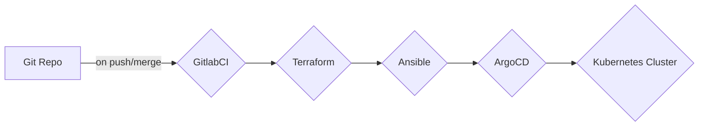
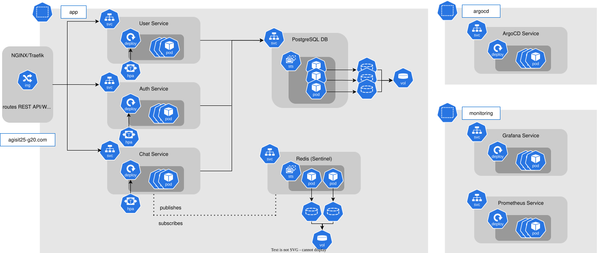
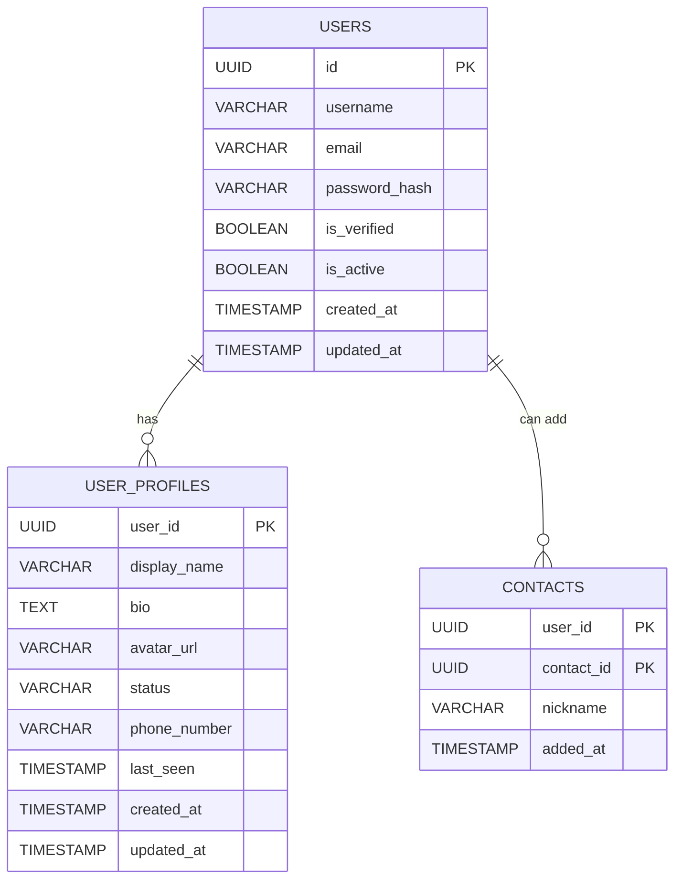
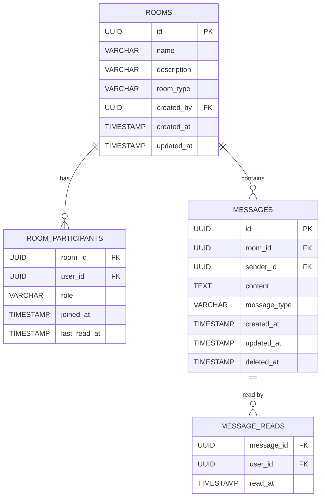

<div align="center">
  <h1>MicroCommunication</h1>
  <h2>Micro-Service based communications App</h2>
  <h3>agisit25-g20</h3>
</div>

## Bootstrapping

To bootstrap our app, we made some convenient commands that help you quickly get started.

- First off, run `just login`; this will redirect you to Google Cloud's login page, where you can authorize the CLI.

- Then, use `just setup_project <project_name>` to set the GCP project gcloud will manage the rest.

- Important Note: Remember to have Compute Engine API and Secret Manager API enabled in your Console.

- Also remember to download your service account into `~/service-account.json` so Ansible and Terraform can use them.

- To provision the VMs, run `just provision`.

- After it finishes executing, to turn the VMs into a Kubernetes cluster run `just configure`.

- And once it finishes (it takes a while), everything is set up!

- Now, if you want to check your cluster's status, run `just argocd-pw` to print your ArgoCD's password.

- To access the ArgoCD's dashboard run, `just argocd`, and use `admin` as the username and the password that was printed in the previous command.

- To access grafana's dashboard, run `just grafana`, and use `admin` as the username and `prom-operator` as the password.

## Development

For development, the principle was to get the templates and setup **right**.

For this, we defined a GitLab CI that would validate and lint all our Terraform files, as well as any YAML files (since there isn't any "code" here, due to it all being IaC, this was the best way to ensure only well-formatted files, reached the repo)

The CI includes the [pre-commit-terraform](https://github.com/antonbabenko/pre-commit-terraform) to validate all terraform files, and [yamllint](https://github.com/adrienverge/yamllint).

## File Structure

The idea was to have a structure that would encapsulate each step in setting up the environment, so that's exactly what we did, with the names being as explicit as possible:

- `app`: where each custom microservice is developed, with all their dependencies and code.

- `ansible`: this is where all the configuration scripts are hosted.

- `terraform`: how the kubernetes nodes are provisioned. Along with that, the GCP machine specifications and networks.

- `k8s-manifests`: Where all our kubernetes manifests are defined, including the `values` for each of the helm charts we used.

- `argocd-apps`: Our ArgoCD apps. It follows the App-of-Apps pattern, and each Application points to a directory inside `k8s-manifests`.

```txt
.
├── ansible
│   ├── ansible.cfg
│   ├── inventories
│   ├── playbooks
│   └── roles
│       ├── common
│       ├── control-plane
│       ├── gitops
│       └── worker
├── app
│   ├── chat
│   ├── ui
│   └── user
├── argocd-apps
├── k8s-manifests
│   ├── app
│   │   ├── chat-service
│   │   ├── ui-service
│   │   └── user-service
│   ├── argocd
│   ├── infrastructure
│   │   ├── monitoring
│   │   └── traefik
│   └── platform
│       ├── keycloak
│       ├── postgres
│       └── redis
└── terraform
```

Each folder handles its workload and sets up the work for the next layer.

The workflow is the following:



This makes sure that each layer has clear **separation of concerns**:

### GitlabCI

GitlabCI is like the puppet master of the whole project.

Each time main gets a commit (or merge request), GitlabCI will deploy jobs that will automatically update our infrastructure and application.

This allows for Continuous Development, with near-instant response from the application once a feature is pushed.

### Terraform

Terraform provisions each VM, which will act as nodes on the Kubernetes cluster.

Its job is very simple, it sets up the base for the kubernetes cluster:

- creates the VMs using a minimal OS

- injects the Ansible SSH keys into the hosts

- creates the GCP Firewall and internal network for the VMs to communicate

You can read more about our Terraform configuration in its [README](./terraform/README.md)

### Ansible

Ansible's job is to configure the machine. To turn what are simple VMs into Kubernetes Nodes, Control Planes and Workers and connect them into a Cluster.

Its job involves:

- installing `kubeadm`, `kubectl` and `kubelet`

- initializing the Control Plane(s) with `kubeadm init`

- creating tokens so the workers can join using `kubeadm join ...`

- installing a [CNI plugin](https://kubernetes.io/docs/concepts/extend-kubernetes/compute-storage-net/network-plugins/) ([Flannel](https://github.com/flannel-io/flannel), [Calico](https://www.tigera.io/project-calico/), [Weaver](https://github.com/weaveworks/weave), etc.)

You can read more about our Ansible configuration in its [README](./ansible/README.md)

### ArgoCD

ArgoCD will live in its own namespace inside the cluster, managing and installing all the apps.

As GitOps, ArgoCD will watch the git repository for any changes and update them to the cluster.

ArgoCD will:

- install our monitoring stack in it's designated namespace

- deploy our microservices (user, auth, chat, etc.)

- configure and deploy our [Ingress](https://kubernetes.io/docs/concepts/services-networking/ingress/) controller, also inside its own namespace

You can read more about our ArgoCD configuration in its [README](./argocd-apps/README.md)

### Kubernetes

After everything is deployed and configured, Kubernetes will manage the pods, as well as [Horizontal Scaling](https://kubernetes.io/docs/tasks/run-application/horizontal-pod-autoscale/) for services with high demand, controlling the lifetime of pods and connecting our entire architecture.

## Application architecture

The idea here is to have a microservice for each "service", a.k.a functionality of the application that can be self-contained and isolated in a container. They all communicate to the DB through a secure connection.

To follow the design principles of kubernetes, our monitoring stack (Grafana, Prometheus, etc.) will be hosted on a different namespace than the application itself.

So, we will have the following [namespaces](https://kubernetes.io/docs/concepts/overview/working-with-objects/namespaces/):

- `traefik`

    - [Ingress Controller](#ingress-controller)

- `app`

    - [UI Service](./app/ui/README.md)

    - [Redis](./app/README.md#redis)

    - [Keycloak](./app/README.md#keycloak)

    - [User Service](./app/user/README.md)

    - [Chat Service](./app/chat/README.md)

    - [PostgreSQL](./app/README.md#keycloak)

- `monitoring`

    - [Monitoring Service](#monitoring-service)

- `argocd`

    - [ArgoCD](#argocd)

This allows for different RBAC for different namespaces, as well as networking and separation of concerns.

The architecture will be as follows:



## Database Architecture

We will have 2 (technically 3) databases:

- `user-service-db`: Used by the user-service to save essential information about the users, their preferences and their contacts

- `chat-service-db`: Used by the chat-service to save essential information about the messages, groups, and other essential information

and the third, "hidden" db:

- `keycloak`: Database managed and owned entirely by Keycloak, our IdP

### User Service DB



### Chat Service DB


