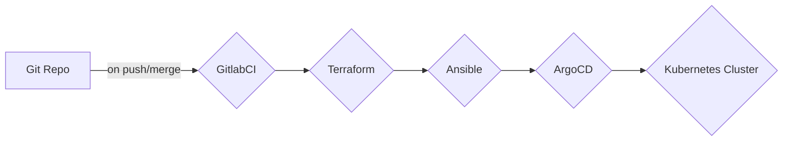
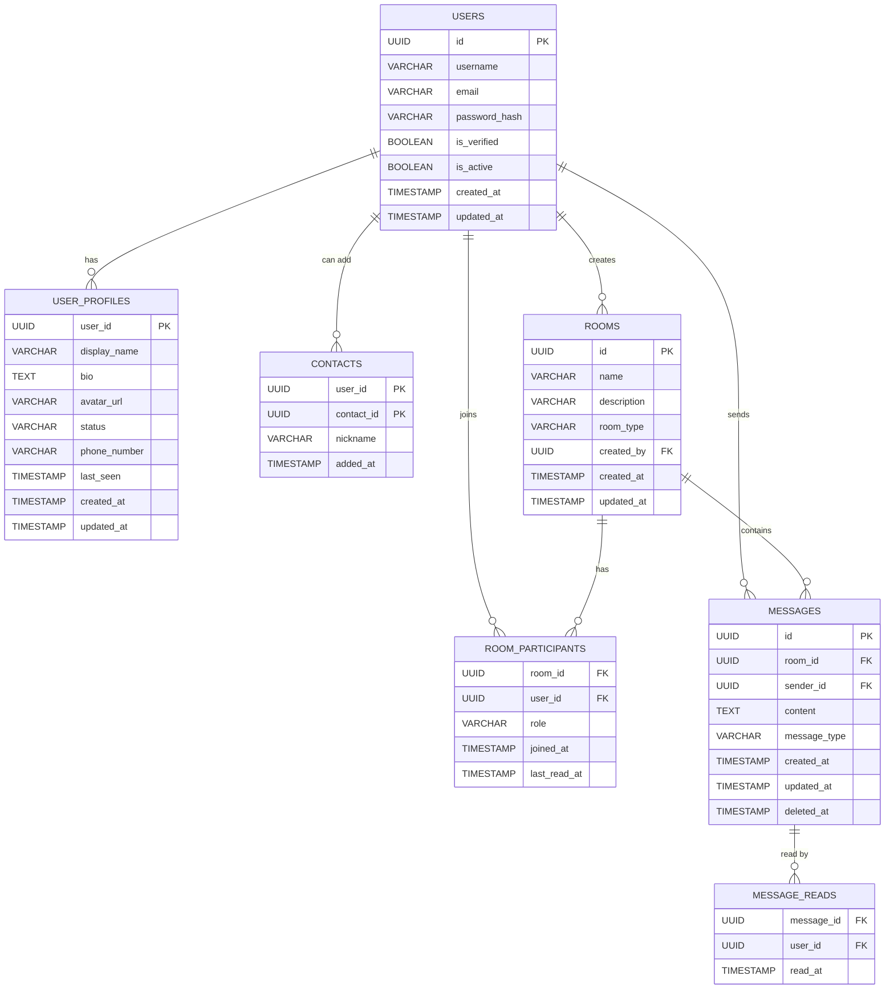

<div align="center">
  <h1>MicroCommunication</h1>
  <h2>Micro-Service based communications App</h2>
  <h3>agisit25-g20</h3>
</div>

## Development

For development, the principle was to get the templates and setup **right**.

For this, we defined a GitLab CI that would validate and lint all our Terraform files, as well as any YAML files (since there isn't any "code" here, due to it all being IaC, this was the best way to ensure only well-formatted files, reached the repo)

The CI includes the [pre-commit-terraform](https://github.com/antonbabenko/pre-commit-terraform) to validate all terraform files, and [yamllint](https://github.com/adrienverge/yamllint).

### Pre-requisites

## File Structure

The idea was to have a structure that would encapsulate each step in setting up the environment, so that's exactly what we did, with the names being as explicit as possible:

- `application`: where the actual application is hosted, along with the code that makes up the front and back ends. This includes the Kubernetes ConfigMap since it's "part" of the application

- `configuration`: this is where all the configuration scripts are hosted. They are managed by Ansible, but other tools could be hosted here

- `infrastructure`: how the kubernetes nodes are provisioned. Along with that, the GCP machine specifications and networks

- `monitoring`: all monitoring software used to ensure uptime and logging.

```txt
├── app
│   ├── kubernetes
│   ├── ui
│   ├── redis
│   ├── database
│   ├── user
│   ├── chat
│   └── auth
├── configuration
│   └── ansible
│       ├── inventory.ini
│       ├── playbooks
│       └── roles
├── infrastructure
│   └── terraform
├── monitoring
│   ├── grafana
│   └── prometheus
```

Each folder handles its workload and sets up the work for the next layer.

The workflow is the following:



This makes sure that each layer has clear **separation of concerns**:

### GitlabCI

GitlabCI is like the puppet master of the whole project.

Each time main gets a commit (or merge request), GitlabCI will deploy jobs that will automatically update our infrastructure and application.

This allows for Continuous Development, with near-instant response from the application once a feature is pushed.

### Terraform

Terraform provisions each VM, which will act as nodes on the Kubernetes cluster.

Its job is very simple, it sets up the base for the kubernetes cluster:

- creates the VMs using a minimal OS

- injects the Ansible SSH keys into the hosts

- creates the GCP Firewall and internal network for the VMs to communicate

### Ansible

Ansible's job is to configure the machine. To turn what are simple VMs into Kubernetes Nodes, Control Planes and Workers.

Its job involves:

- installing `kubeadm`, `kubectl` and `kubelet`

- initializing the Control Plane(s) with `kubeadm init`

- creating tokens so the workers can join using `kubeadm join ...`

- installing a [CNI plugin](https://kubernetes.io/docs/concepts/extend-kubernetes/compute-storage-net/network-plugins/) ([Flannel](https://github.com/flannel-io/flannel), [Calico](https://www.tigera.io/project-calico/), [Weaver](https://github.com/weaveworks/weave), etc.)

### ArgoCD

ArgoCD will live in its own namespace inside the cluster, managing and installing all the apps.

As GitOps, ArgoCD will watch the git repository for any changes and update them to the cluster.

ArgoCD will:

- install our monitoring stack in it's designated namespace

- deploy our microservices (user, auth, chat, etc.)

- configure and deploy our [Ingress](https://kubernetes.io/docs/concepts/services-networking/ingress/) controller

### Kubernetes

After everything is deployed and configured, Kubernetes will manage the pods, as well as [Horizontal Scaling](https://kubernetes.io/docs/tasks/run-application/horizontal-pod-autoscale/) for services with high demand, controlling the lifetime of pods and connecting our entire architecture.

## Application architecture

The idea here is to have a microservice for each "service", a.k.a functionality of the application that can be self-contained and isolated in a container. They all communicate to the DB through a secure connection.

To follow the design principles of kubernetes, our monitoring stack (Grafana, Prometheus, etc.) will be hosted on a different namespace than the application itself.

So, we will have the following [namespaces](https://kubernetes.io/docs/concepts/overview/working-with-objects/namespaces/):

- `ingress`

    - [Ingress Controller](#ingress-controller)

- `app`

    - [UI Service](#ui-service)

    - [Redis Service](#redis-service)

    - [Auth Service](#auth-service)

    - [User Service](#user-service)

    - [Chat Service](#chat-service)

    - [DB Service](#db-service)

- `monitoring`

    - [Monitoring Service](#monitoring-service)

- `argocd`

    - [ArgoCD](#argocd)

This allows for different RBAC for different namespaces, as well as networking and separation of concerns.

The architecture will be as follows:


If time allows it, we will try to have a more production-ready approach to namespaces, separating them into:

- `app-backend`: this is where the [user](#user-service), [auth](#auth-service) and [chat](#chat-service) will live

- `app-frontend`: the [ui](#ui-service) will live alone in this namespace

- `app-data`: the [redis](#redis-service) and [db](#db-service) components will be hosted in this namespace

## Database Architecture



### Ingress Controller

### UI Service

### Redis Service

### Auth Service

### User Service

### Chat Service

### DB Service

### Monitoring Service

### ArgoCD
