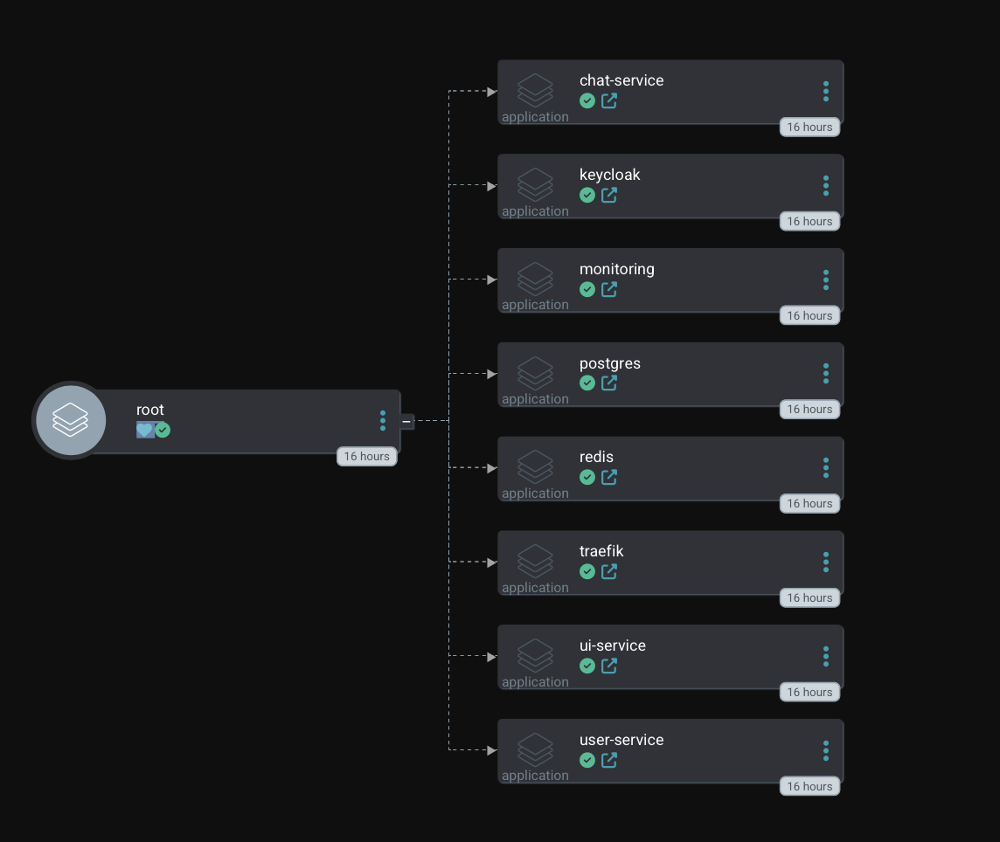

# ArgoCD Applications

## Architecture



The infrastructure is organized into three deployment waves using sync-wave annotations:

- **Wave 0**: Core infrastructure &rarr; Monitoring
- **Wave 1**: Ingress &rarr; Traefik
- **Wave 2**: Platform services &rarr; PostgreSQL, Redis
- **Wave 3**: Identity management &rarr; Keycloak
- **Wave 5**: Application services &rarr; User, UI, Chat

## Namespaces

- `argocd`: ArgoCD control plane
- `monitoring`: Prometheus, Grafana
- `traefik`: Ingress controller
- `app`: Platform services (PostgreSQL, Redis, Keycloak) and Application services (User, Chat, UI)

## Applications by Layer

- **Infrastructure**: Traefik, Monitoring
- **Platform**: PostgreSQL, Redis, Keycloak
- **Application**: User Service, Chat Service, UI Service

## Deployment

1. Verify requirements with `just requirements`
2. Login to gcloud with `just login`
3. Set your GCP project with `just setup_project <your-project-id>` (in our case agisit-g20)
4. Provision infrastructure with `just provision`
5. Run `just ssh-master` on two different terminal windows
6. On the first terminal window, you have to do port forwarding to access ArgoCD dashboard with `kubectl port-forward svc/argocd-server -n argocd 8080:443`
7. On the second terminal window, run `kubectl -n argocd get secret argocd-initial-admin-secret -o jsonpath="{.data.password}" | base64 -d` to get ArgoCD dashboard password

## Configuration

### Development Workflow

1. Make changes to manifests in the Git repository
2. Commit and push to the target branch
3. ArgoCD automatically detects changes and syncs
4. Monitor sync status in ArgoCD dashboard or CLI

### Target Branch

[//]: # (Branch can be changed later on in production)

All applications target the `4-microservice-structure` branch.

## Managing Applications

### List Apps & Status

```bash
kubectl get applications -n argocd
```

### View Apps Logs

```bash
kubectl get pods -n <namespace>
kubectl logs <pod-name> -n <namespace>
```
